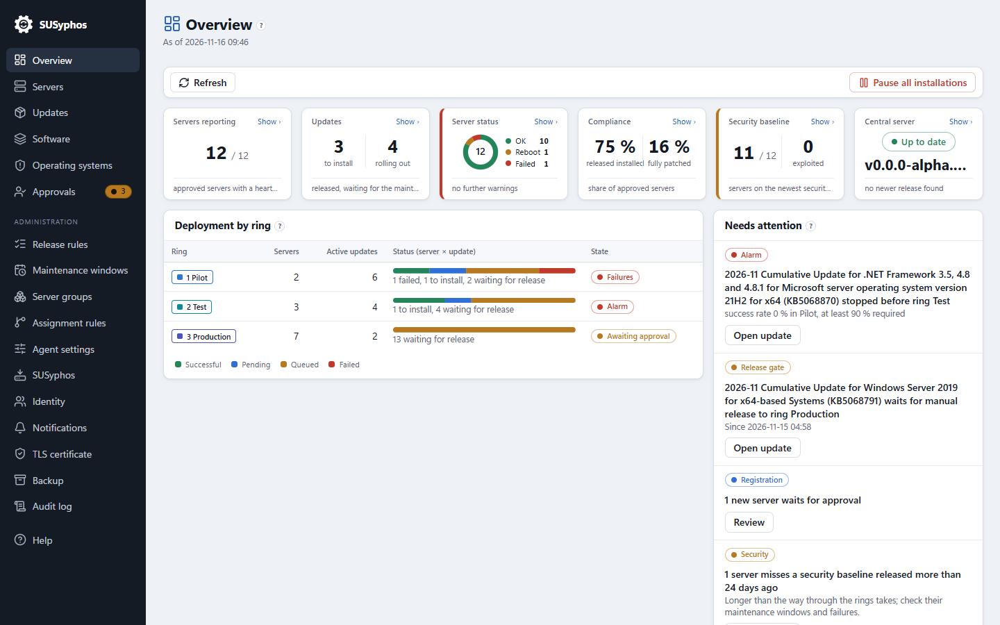
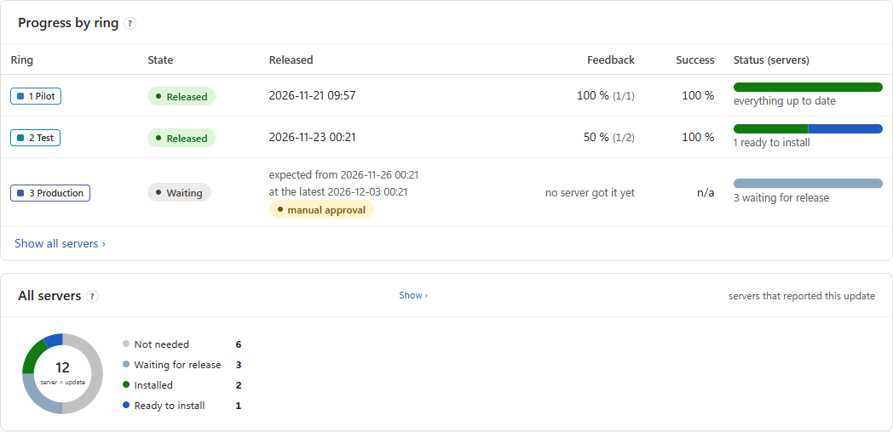
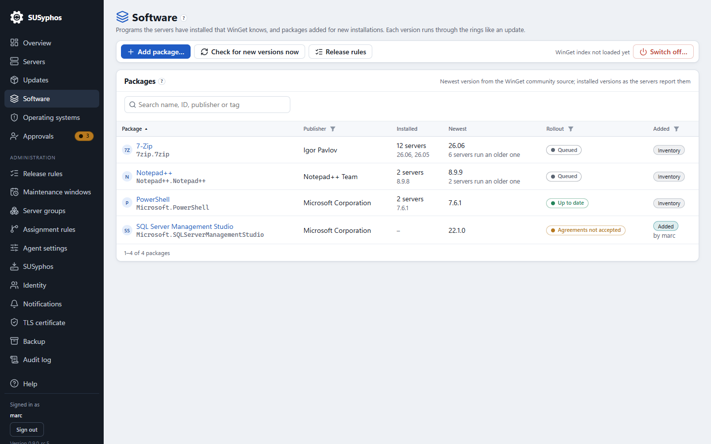
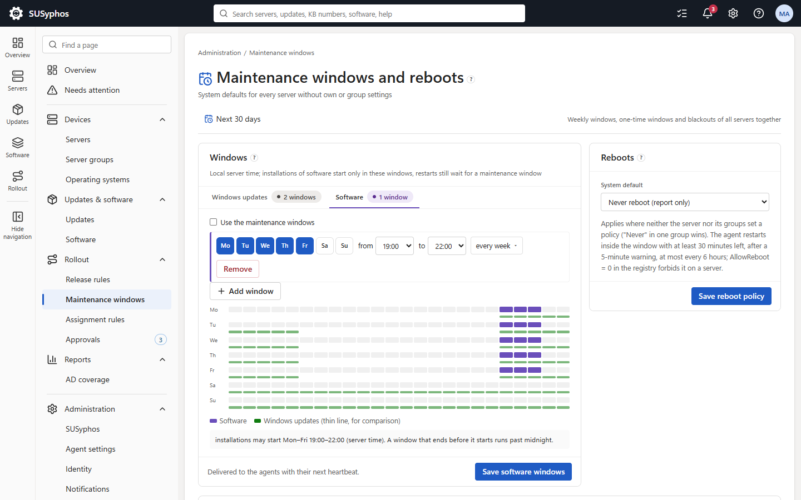
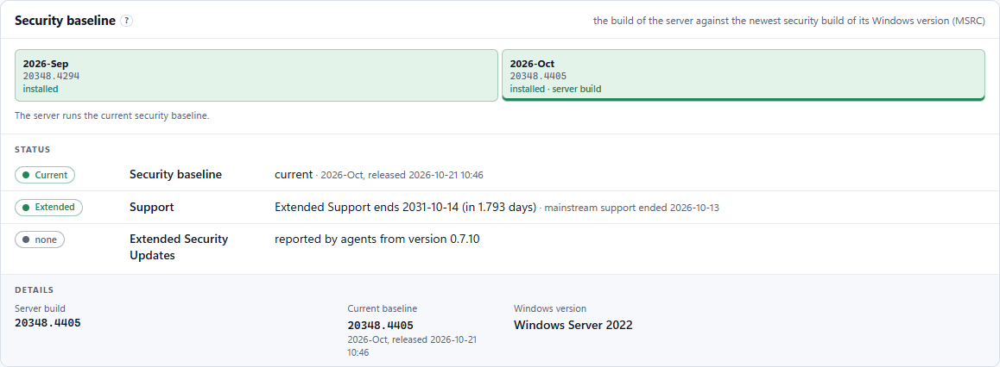

  

<h1 align="center">SUSyphos</h1>

  <b>Patch your Windows Servers in rings, from one dashboard.</b> 
  A self-hosted, lightweight successor to WSUS. Free and open source.

  
  
  
  

Microsoft has deprecated WSUS. SUSyphos takes its place: a small agent on every server, one central server with a web dashboard, and updates that move through **Pilot**, **Test** and **Production** on their own. No WSUS database, no SQL Server, no content sync.

> [!NOTE]
> **Public beta: [SUSyphos 0.9.0-rc.8](https://github.com/debold/UpdateCoordinator/releases/tag/release/v0.9.0-rc.8) is out**, a release candidate with third-party software through WinGet. Try it in a lab and tell us what you think in [Issues](https://github.com/debold/UpdateCoordinator/issues). The packages are not code-signed yet; check them against `SHA256SUMS.txt`.

## What makes it different

<table>
  <tr>
    <td width="45%">
      <h3>Rings instead of approvals</h3>
      Updates start by rule, wait a set number of days in each ring and move on when the success rate is right. A manual gate before Production stops anything that went wrong in Pilot.
    </td>
    <td></td>
  </tr>
  <tr>
    <td width="45%"></td>
    <td>
      <h3>Software too, through the same rings</h3>
      See every installed program on every server, update it with WinGet through the same rings, roll out new software to groups and uninstall it again. Signed PowerShell scripts can run before and after an installation. Every installer is checked against its SHA-256 and virus-scanned on the central server first.
    </td>
  </tr>
  <tr>
    <td width="45%">
      <h3>Windows that fit real calendars</h3>
      Maintenance windows per group or server: weekdays plus "only the 2nd week" or "every week except the last". Software can get its own evening windows. Servers restart only where a rule allows it.
    </td>
    <td></td>
  </tr>
  <tr>
    <td width="45%"></td>
    <td>
      <h3>Security at a glance</h3>
      Every server against Microsoft's newest security build, with CVEs, exploited vulnerabilities and end-of-support dates for each Windows version.
    </td>
  </tr>
</table>

## How it works

| Microsoft Update | Agent | Central server | You |
|---|---|---|---|
| Agents download updates straight from Microsoft, as today. | A Windows service on every server. It asks, it never listens. | Decides what each ring may install and when. SQLite, one MSI. | Watch, approve and step in from the browser. Sign in with Windows. |

## Quick start

1. Download `SUSyphos.Server` and `SUSyphos.Agent` from the [latest release](https://github.com/debold/UpdateCoordinator/releases) and check them against `SHA256SUMS.txt`.
2. Install the central server on Windows Server 2016 or later; setup shows the address and a one-time token for the first admin.
3. Roll out the agent by GPO, Intune or Configuration Manager.
4. Approve the servers, put them into rings and set your windows.

[Admin guide](docs/admin/README.md) · [Changelog](CHANGELOG.md) · [Releases](https://github.com/debold/UpdateCoordinator/releases) · [Build from source](docs/development.md)

## License

[MIT](LICENSE) © Marc Debold. Icons from [Lucide](https://lucide.dev) (ISC), PowerShell highlighting in the script editor by [Prism](https://prismjs.com) (MIT).
