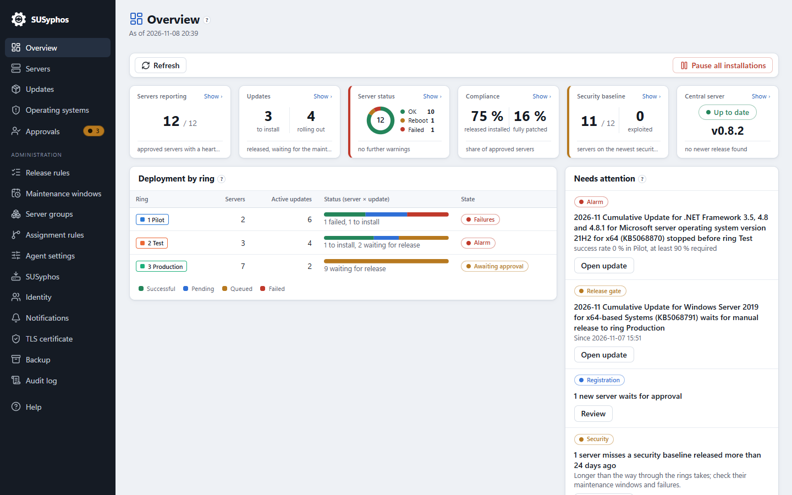
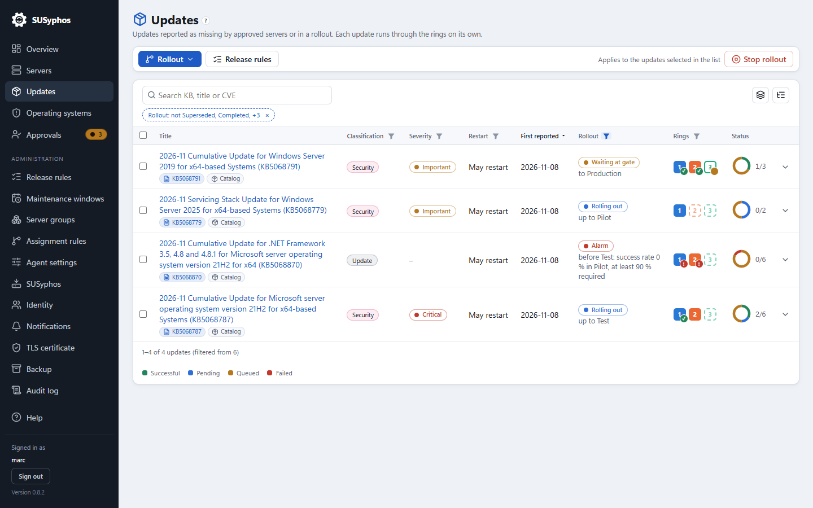
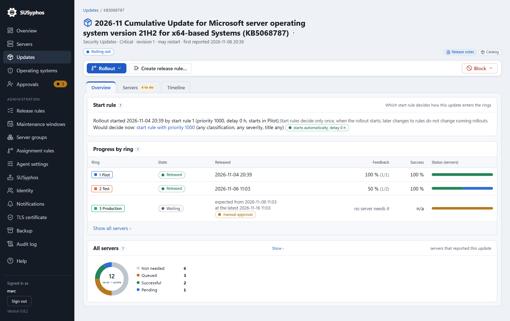
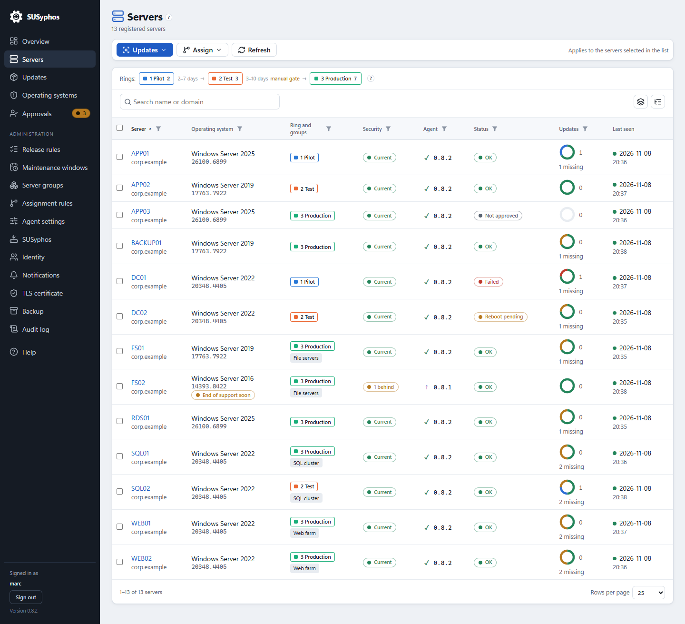
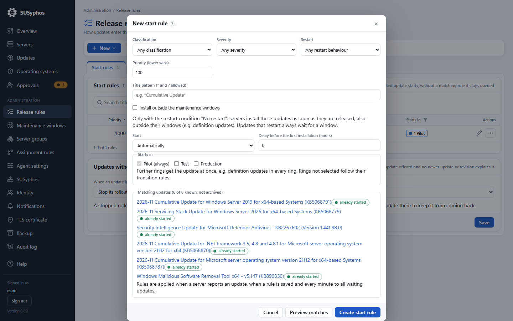

  

<h1 align="center">SUSyphos</h1>

  <b>Ring-based Windows Server patching with one central dashboard.</b> 
  A lightweight, self-hosted alternative to WSUS.

  
  
  
  
  

> [!NOTE]
> **Public beta: [SUSyphos 0.8.2](https://github.com/debold/UpdateCoordinator/releases/tag/release/v0.8.2) is out.** Try it in a lab and tell us what you think in [Issues](https://github.com/debold/UpdateCoordinator/issues). The packages are not code-signed yet; check them against `SHA256SUMS.txt`.

## Why SUSyphos

- **Rings instead of approvals.** Updates move from Pilot to Test to Production on their own, with waiting days and an optional manual gate before Production.
- **Maintenance windows that fit real calendars.** Weekdays plus "only the 2nd week" or "every week except the last". Reboots only where a rule allows them.
- **Updates straight from Microsoft.** No WSUS database, no content sync, no SQL Server. Agents use the Windows Update Agent API; Microsoft Update per group.
- **Security at a glance.** Missing builds, CVEs and exploited vulnerabilities from Microsoft's security data, plus end-of-support warnings per Windows version.
- **Safe by design.** Agents trust the central server through a pinned anchor, admins sign in with Windows (AD groups map to roles), every action lands in the audit log.
- **Small footprint.** One MSI for the central server, one for the agent, both self-contained. Distribute the agent by GPO, Intune or Configuration Manager.

## Screenshots

<table>
  <tr>
    <td width="50%"> <b>Updates</b>: classification, severity and where each update stands in the rings, including gates and alarms</td>
    <td width="50%"> <b>Update page</b>: progress by ring with release dates, success rate and the manual gate before Production</td>
  </tr>
  <tr>
    <td> <b>Servers</b>: OS build, ring and groups, security state, agent version and status</td>
    <td> <b>Release rules</b>: decide which updates start automatically, with a preview of the matches</td>
  </tr>
</table>

## Status and roadmap

| | Version | What it covers |
|---|---|---|
| ✅ **Beta** | 0.8.x | Windows updates and drivers, rings and groups, maintenance windows, reboot rules, security baseline and CVEs, end-of-support tracking, notifications by mail and webhook, AD sign-in, backup, built-in help |
| 🚧 **In progress** | 0.9 | Third-party software through WinGet: software inventory on all servers, updates through the same rings, and new installations picked from the WinGet catalog (Windows Server 2019 and later with Desktop Experience) |
| 🗓️ **Later** | | Code signing, self-update of the central server |

See the [changelog](CHANGELOG.md) for every release.

## Quick start

1. Download `SUSyphos.Server` and `SUSyphos.Agent` from the [latest release](https://github.com/debold/UpdateCoordinator/releases) and check them against `SHA256SUMS.txt`.
2. Install the central server MSI on a Windows Server 2016 or later. Setup shows the port (default 8443) and a one-time token for the first admin account.
3. Install the agent on your servers and point it to the central server (MSI property `SERVERURL` or group policy).
4. Approve the new servers in the dashboard, put them into rings, and set your maintenance windows.

Full guide: [admin documentation](docs/admin/README.md).

## Documentation

[Admin guide](docs/admin/README.md) · [Architecture](docs/01-architecture.md) · [Build from source](docs/development.md) · [Changelog](CHANGELOG.md)

## License

[MIT](LICENSE) © Marc Debold. Icons from [Lucide](https://lucide.dev) (ISC).
